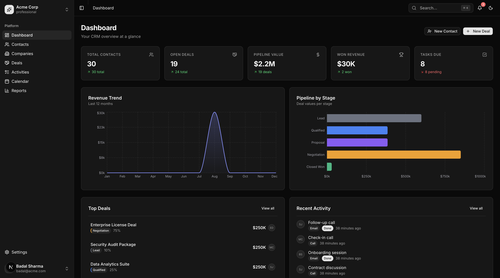
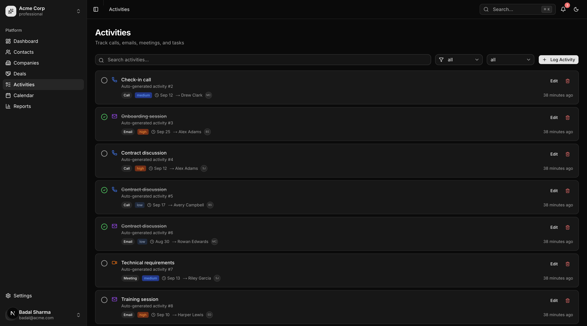
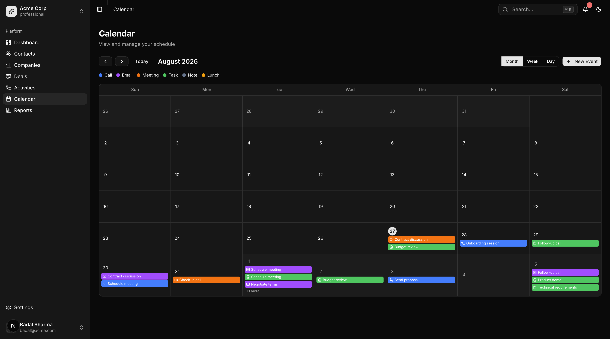
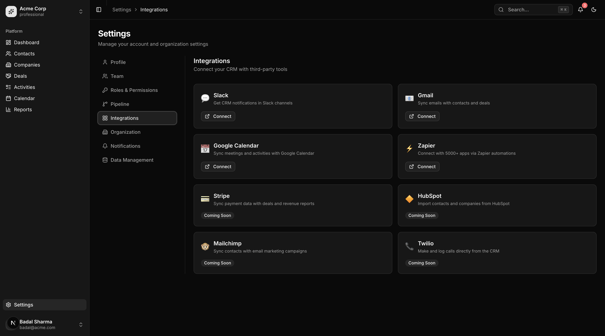

<p align="center">
  <h1 align="center">NextCRM</h1>
  <p align="center">
    A modern, open-source CRM built with Next.js 16 and FastAPI.
    <br />
    Manage contacts, companies, deals, and pipelines — all in one place.
  </p>
</p>

<p align="center">
  <a href="#features">Features</a> &middot;
  <a href="#tech-stack">Tech Stack</a> &middot;
  <a href="#quick-start">Quick Start</a> &middot;
  <a href="#docker-deployment">Docker Deployment</a> &middot;
  <a href="#production-deployment">Production Deployment</a> &middot;
  <a href="#app-cli">App CLI</a> &middot;
  <a href="#architecture">Architecture</a> &middot;
  <a href="#api-overview">API</a> &middot;
  <a href="#contributing">Contributing</a>
</p>

<p align="center">
  <a href="https://github.com/sharmabadal15/nextcrm-opensource/stargazers">
    
  </a>
  <a href="https://github.com/sharmabadal15/nextcrm-opensource/blob/main/LICENSE">
    
  </a>
  
  
  
  
  
</p>

---

## Screenshots

<p align="center">
  
  <br />
  <em>Dashboard — KPI cards, revenue trends, pipeline overview, top deals & recent activity</em>
</p>

<details>
<summary><strong>More screenshots</strong></summary>

| Deals (Kanban Board) | Activities |
|---|---|
|  |  |

| Calendar | Settings & Integrations |
|---|---|
|  |  |

</details>

---

## Features

### Core CRM
- **Contacts** — Full CRUD, search, filters, pagination, sorting, bulk operations, CSV export
- **Companies** — Company management with linked contacts and deals
- **Deals** — Kanban pipeline board with drag-and-drop + list view toggle
- **Activities** — Track calls, emails, meetings, tasks with priority levels and completion toggle
- **Calendar** — Month, week, and day views with color-coded activity types
- **Reports** — Pipeline, revenue, activity, and sales performance analytics with charts

### Productivity
- **Dashboard** — KPI cards, revenue trends, pipeline overview, recent activity feed
- **Global Search** — `Cmd+K` command palette searches across contacts, companies, and deals
- **Keyboard Shortcuts** — Full shortcut system (`?` to view all shortcuts)
- **Rich Text Notes** — Tiptap editor with formatting, links, and mentions
- **File Attachments** — Drag-and-drop upload with progress tracking
- **CSV Import/Export** — 4-step import wizard with column mapping and validation
- **Notifications** — In-app notification system with unread badges

### Settings & Administration
- **Team Management** — Invite members, assign roles (Admin / Manager / Sales Rep / Viewer)
- **RBAC** — Role-based access control with permissions matrix
- **Pipeline Configuration** — Customize stages, win percentages, and colors
- **Organization Settings** — Branding, currency, timezone configuration
- **Integration Cards** — Slack, Gmail, Google Calendar, Zapier, and more (coming soon)

### Developer Experience
- **Dark / Light Mode** — System-aware theme with manual toggle
- **Optimistic UI** — Instant feedback with TanStack Query mutations and rollback on error
- **URL-Driven State** — Filters, pagination, and search state stored in URL params
- **Loading Skeletons** — Purpose-built skeleton loaders for every view
- **Error Boundaries** — Global error and 404 pages with recovery
- **BFF Proxy** — Backend-for-Frontend pattern: all API calls go through same-origin, no CORS
- **Multi-Tenant** — Data isolation via `organization_id` on every query
- **Docker Ready** — One-command dev and production deployment

---

## Tech Stack

### Frontend (`crm-app-next/`)

| Category | Technology |
|---|---|
| Framework | [Next.js 16](https://nextjs.org/) (App Router, React 19) |
| Language | TypeScript (strict mode) |
| Styling | Tailwind CSS v4 |
| Components | [shadcn/ui](https://ui.shadcn.com/) |
| Data Fetching | TanStack Query v5 |
| Tables | TanStack Table v8 |
| State | Zustand v5 |
| Forms | React Hook Form + Zod v4 |
| Charts | Recharts |
| Drag & Drop | @dnd-kit |
| Rich Text | Tiptap |
| Auth | NextAuth v5 |

### Backend (`backend/`)

| Category | Technology |
|---|---|
| Framework | [FastAPI](https://fastapi.tiangolo.com/) (async) |
| Language | Python 3.12+ |
| Database | PostgreSQL 16 + pgvector |
| ORM | SQLAlchemy 2.0 (async) |
| Migrations | Alembic |
| Cache | Redis 7 |
| Task Queue | Celery |
| File Storage | MinIO (S3-compatible) |
| Auth | JWT (python-jose + bcrypt) |

---

## Quick Start

### Prerequisites

- [Docker](https://docs.docker.com/get-docker/) & Docker Compose

That's it. Everything runs in containers.

### 1. Clone and start

```bash
git clone https://github.com/sharmabadal15/nextcrm-opensource.git
cd nextcrm-opensource
app start
```

This will:
- Create `.env` from `.env.example` (if not present)
- Build all Docker images (frontend, backend, database, redis, minio)
- Start all services in the background

### 2. Run migrations and seed data

```bash
app migrate
app seed
```

### 3. Open the app

| Service | URL |
|---|---|
| App (Frontend) | [http://localhost:3000](http://localhost:3000) |
| API Docs (Swagger) | [http://localhost:8000/docs](http://localhost:8000/docs) |
| MinIO Console | [http://localhost:9001](http://localhost:9001) |

**Demo login:**

```
Email:    badal@acme.com
Password: password123
```

> **Note:** If `app` is not found, use `./app` instead, or add the project directory to your PATH.

---

## Docker Deployment

### Development (default)

Development mode uses hot-reload for both frontend and backend. Source code is mounted into containers so changes are reflected immediately.

```bash
app start          # Build & start all services
app logs           # Tail logs (all services)
app logs api       # Tail logs for a specific service
app stop           # Stop all services
app restart        # Rebuild & restart
```

**Development services and ports:**

| Service | Container | Port |
|---|---|---|
| Next.js Frontend | `crm-frontend` | `3000` |
| FastAPI Backend | `crm-api` | `8000` |
| PostgreSQL | `crm-db` | `5433` |
| Redis | `crm-redis` | `6379` |
| MinIO API | `crm-minio` | `9000` |
| MinIO Console | `crm-minio` | `9001` |

### Configuration

Copy and edit the environment file:

```bash
cp .env.example .env
```

Key variables in `.env`:

| Variable | Default | Description |
|---|---|---|
| `POSTGRES_PASSWORD` | `crm_password_change_me` | Database password |
| `JWT_SECRET_KEY` | `change-me-...` | JWT signing key |
| `AUTH_SECRET` | `generate-me-...` | NextAuth session secret |
| `FRONTEND_PORT` | `3000` | Frontend port |
| `API_PORT` | `8000` | Backend API port |

---

## Production Deployment

Production mode uses Nginx as a reverse proxy, production-optimized builds (standalone Next.js, multi-worker Uvicorn), and keeps all internal services (database, redis, minio) unexposed.

### 1. Configure environment

```bash
cp .env.production.example .env
```

Edit `.env` with real values:

```env
# Your server IP or domain
PUBLIC_URL=http://your-server-ip

# Generate real secrets
JWT_SECRET_KEY=<run: openssl rand -base64 64>
AUTH_SECRET=<run: openssl rand -base64 32>

# Strong passwords
POSTGRES_PASSWORD=<strong-password>
MINIO_ROOT_PASSWORD=<strong-password>
```

### 2. Deploy

```bash
app deploy
```

This will:
- Build production Docker images (optimized, no dev dependencies)
- Start all services with Nginx reverse proxy on port 80
- Run database migrations automatically

### 3. Seed demo data (optional)

```bash
app seed
```

### Production architecture

```
Internet
   |
   v
[Nginx :80]  ──────────────────────────────
   |                    |                  |
   v                    v                  v
/api/v1/*           /docs, /health      /* (everything else)
   |                    |                  |
   v                    v                  v
[FastAPI :8000]    [FastAPI :8000]     [Next.js :3000]
   |
   v
[PostgreSQL] [Redis] [MinIO] [Celery Worker]
```

**All traffic goes through Nginx on port 80.** Internal services are not exposed to the host.

| Public URL | Routed To |
|---|---|
| `http://your-ip/` | Next.js frontend |
| `http://your-ip/api/v1/...` | FastAPI backend |
| `http://your-ip/api/auth/...` | Next.js BFF (auth proxy) |
| `http://your-ip/docs` | Swagger API docs |
| `http://your-ip/health` | Health check |

### Access from other devices

The app is accessible from any device on the same network using your server's IP address. Find your IP:

```bash
# macOS
ipconfig getifaddr en0

# Linux
hostname -I | awk '{print $1}'
```

Then open `http://<your-ip>` on any device.

### HTTPS (optional)

For HTTPS, put Cloudflare, Caddy, or Certbot in front of Nginx. The simplest option is Cloudflare Tunnel (free, no port forwarding needed).

---

## App CLI

The `app` script is the single entry point for all operations. It wraps Docker Compose and handles environment detection automatically.

```
Usage: app <command>

Commands:
  start     Start development environment (ports 3000, 8000)
  deploy    Build & deploy production (Nginx on port 80)
  stop      Stop all services
  restart   Restart all services
  status    Show running containers
  logs      Tail Docker logs (e.g. app logs api)
  migrate   Run database migrations
  seed      Seed demo data
  reset     Stop and remove all data volumes
```

**Examples:**

```bash
app start                    # Start dev environment
app deploy                   # Deploy production
app logs api                 # Tail API logs only
app logs frontend            # Tail frontend logs only
app status                   # Check container health
app seed                     # Load demo data
app reset                    # Wipe everything and start fresh
```

> Set `NEXTCRM_ENV=production` to make `app stop/restart/logs` use the production compose file by default.

---

## Architecture

```
nextcrm-opensource/
├── app                        # CLI script (start, stop, deploy, etc.)
├── docker-compose.yml         # Development Docker Compose
├── docker-compose.prod.yml    # Production Docker Compose (Nginx + prod builds)
├── nginx/
│   └── nginx.conf             # Reverse proxy config
├── .env.example               # Dev environment template
├── .env.production.example    # Production environment template
│
├── backend/                   # FastAPI Python backend
│   ├── app/
│   │   ├── main.py            # App factory, router registration
│   │   ├── config.py          # Environment settings (pydantic-settings)
│   │   ├── database.py        # Async SQLAlchemy engine
│   │   ├── seed.py            # Demo data seeder
│   │   ├── core/              # Security, RBAC, pagination
│   │   ├── middleware/        # Logging, tenant isolation
│   │   ├── modules/           # Domain modules (DDD pattern)
│   │   │   ├── auth/          # JWT login, register, refresh, me
│   │   │   ├── contacts/      # Contact CRUD
│   │   │   ├── companies/     # Company CRUD
│   │   │   ├── deals/         # Deals + Kanban stage management
│   │   │   ├── pipelines/     # Pipeline + stage configuration
│   │   │   ├── activities/    # Activity tracking
│   │   │   ├── users/         # Team management
│   │   │   └── ...            # Notes, files, notifications, etc.
│   │   └── workers/           # Celery background tasks
│   ├── alembic/               # Database migrations
│   ├── Dockerfile             # Multi-stage (base → development / production)
│   └── .dockerignore
│
├── crm-app-next/              # Next.js 16 frontend
│   ├── src/
│   │   ├── app/               # App Router pages
│   │   │   ├── (auth)/        # Login, register
│   │   │   ├── (dashboard)/   # All CRM pages
│   │   │   └── api/           # BFF proxy routes, NextAuth
│   │   ├── components/        # UI components
│   │   │   ├── layout/        # Sidebar, header, command palette
│   │   │   ├── shared/        # DataTable, dialogs, editors
│   │   │   └── ui/            # shadcn/ui primitives (28 components)
│   │   ├── features/          # Feature modules
│   │   │   ├── contacts/      # Components, hooks, schemas
│   │   │   ├── companies/
│   │   │   ├── deals/         # Kanban + list views
│   │   │   ├── activities/
│   │   │   ├── calendar/
│   │   │   └── reports/
│   │   ├── services/          # API client layer
│   │   ├── stores/            # Zustand state (auth, UI, notifications)
│   │   └── types/             # TypeScript definitions
│   ├── Dockerfile             # Multi-stage (deps → builder → production / development)
│   └── .dockerignore
│
└── docs/
    └── screenshots/           # App screenshots
```

### Design Principles

- **Feature-based architecture** — Each domain module is self-contained with its own components, hooks, schemas, and service layer
- **API abstraction** — Service layer decouples UI from backend; swap implementations without touching components
- **Server-first rendering** — Server components at layout level, client boundary pushed to leaf components
- **Optimistic updates** — TanStack Query mutations update cache immediately, roll back on error
- **URL as state** — Table filters, search, pagination all stored in URL search params via `nuqs`
- **Multi-tenant by default** — Every query scoped to `organization_id` from the JWT token
- **BFF proxy** — Frontend API routes proxy to the backend, keeping backend URLs internal

---

## API Overview

The backend exposes a RESTful API with Swagger documentation at `/docs`. All endpoints are prefixed with `/api/v1`.

| Module | Endpoints | Description |
|---|---|---|
| **Auth** | `POST /login`, `/register`, `/refresh`, `/me` | JWT authentication |
| **Contacts** | `GET/POST/PATCH/DELETE /contacts` | Contact management with search & filters |
| **Companies** | `GET/POST/PATCH/DELETE /companies` | Company management |
| **Deals** | `GET/POST/PATCH/DELETE /deals`, `PATCH /deals/{id}/stage` | Deal pipeline + Kanban |
| **Activities** | `GET/POST/PATCH/DELETE /activities`, `PATCH /{id}/toggle` | Activity tracking |
| **Pipelines** | `GET /pipelines` | Pipeline & stage configuration |
| **Users** | `GET/PATCH/DELETE /users` | Team management |
| **Dashboard** | `GET /dashboard/stats`, `/recent-activity` | Dashboard KPIs |
| **Reports** | `GET /reports/pipeline`, `/revenue`, `/activity` | Analytics |
| **Files** | `POST/GET/DELETE /files` | File uploads (MinIO) |
| **Notifications** | `GET/PATCH /notifications` | In-app notifications |

All list endpoints support pagination (`page`, `perPage`), search, sorting (`sort[field]`, `sort[direction]`), and filtering.

### Demo credentials

| User | Email | Password | Role |
|---|---|---|---|
| Badal Sharma | `badal@acme.com` | `password123` | Admin |
| Sarah Johnson | `sarah@acme.com` | `password123` | Manager |
| Mike Chen | `mike@acme.com` | `password123` | Sales Rep |
| Emily Davis | `emily@acme.com` | `password123` | Sales Rep |
| James Wilson | `james@acme.com` | `password123` | Viewer |

---

## Development

### Backend commands

```bash
# View logs
app logs api

# Run tests
docker compose exec api pytest

# Create migration
docker compose exec api alembic revision --autogenerate -m "description"

# Apply migrations
app migrate

# Lint
docker compose exec api ruff check .
```

### Frontend commands

```bash
cd crm-app-next

# Dev server (if running outside Docker)
pnpm dev

# Type check
pnpm build

# Lint
pnpm lint

# Format
npx prettier --write .
```

### Manual setup (without Docker)

<details>
<summary>Step-by-step instructions for running without Docker</summary>

#### 1. Start infrastructure

```bash
cd backend
docker compose up -d    # Starts PostgreSQL, Redis, MinIO only
```

#### 2. Start the backend

```bash
cd backend
pip install -e .
alembic upgrade head
python -m app.seed
uvicorn app.main:app --host 0.0.0.0 --port 8000 --reload
```

#### 3. Start the frontend

```bash
cd crm-app-next
pnpm install
cp .env.example .env.local
# Edit .env.local — set AUTH_SECRET and BACKEND_API_URL
pnpm dev
```

</details>

---

## Roadmap

- [ ] Wire all frontend services to the real backend (currently auth is live, other modules use mock data)
- [ ] Full implementation of Notes, Files, Notifications modules
- [ ] Dashboard and Reports backend aggregation queries
- [ ] Email integration (SMTP via SendGrid / AWS SES)
- [ ] Audit logs with before/after diffs
- [ ] Custom fields (dynamic field definitions per entity)
- [ ] Tags system with tag-based filtering
- [ ] Global full-text search (PostgreSQL `tsvector`)
- [ ] Workflow automation (trigger-based actions)
- [ ] AI features — RAG chat, smart email drafts, lead scoring (pgvector + LangChain)
- [ ] Mobile-optimized API
- [ ] Multi-language support (i18n)

---

## Contributing

Contributions are welcome! Please see [CONTRIBUTING.md](CONTRIBUTING.md) for guidelines.

1. Fork the repository
2. Create your feature branch (`git checkout -b feature/amazing-feature`)
3. Commit your changes (`git commit -m 'Add amazing feature'`)
4. Push to the branch (`git push origin feature/amazing-feature`)
5. Open a Pull Request

---

## License

This project is licensed under the MIT License. See [LICENSE](LICENSE) for details.

---

<p align="center">
  Built by <a href="https://github.com/sharmabadal15">Badal Sharma</a>
</p>
